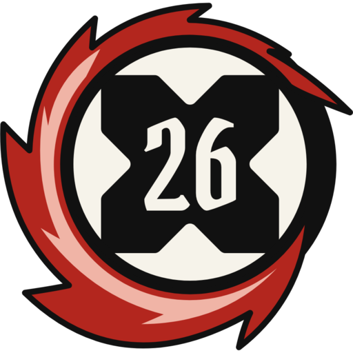

# Superfox26



What better way to put the Supercon X ('26) badge to use than a web browser you can hang on a wall?

Superfox26 supports a decent subset of HTML5/CSS3 and runs on the ESP32 S3 on the Supercon X badge. 

It renders pages and images using a tone system using custom waveforms to nudge the black, white, and red ink particles into tones and shades instead of solid BWR colors. Dithering on top of that.

Easy WebSerial installer and config UI at https://superfox26.hencke.net

This is the more polished version of my submission to Hackaday Supercon X ('26) badge hack contest.

First, I started experimenting with generating tones with what is effectively intentionally ghosting effects. Waveforms that nudge the ink in short bursts that don't push the ink particles all the way. Then I hacked litehtml to use a LOT less RAM, so that rendering can fit in the 8MB PSRAM. I loaded it up with some macro photos (including the strawberry), some XKCD, Hackaday website, etc.

After the con, I polished it up, got the tone system DC balanced so it won't burn your e-ink panel, and make it easier to install and set up.

## Warnings, etc.

HTTPS server certificates are not verified. `sdkconfig.defaults` sets `CONFIG_ESP_TLS_INSECURE` and
`CONFIG_ESP_TLS_SKIP_SERVER_CERT_VERIFY`. Any page the badge fetches is treated as public.

This is mostly hacked together, there could be bugs. Bugs around DC balance could cause burn in, which I've done plenty of times during development, and fortunately has seemed to fix itself over a few hours.

In theory a bug could crash part way through a draw and restart, re-draw, crash again, and cause lots of DC imbalance, destroying the display. I try to detect that during boot and stop the badge. If that happens, it flashes 1 red LED until it is power cycled.

The stock badge powers the LEDs even during sleep, and there's no way to cut power to them, without actually cutting traces. Reports of measuring 8mA draw, and datasheet looks like about 0.7mA per, which puts the best stock badge run/sleep time at around 9 days before needing a charge.

## Install with the web installer

The web installer is the page in `webinstall/`. It installs the firmware and sets WiFi and the page
list over Web Serial. Web Serial needs a Chromium-based browser, such as Chrome, Brave, Edge, etc., and a
secure context for browsers to trust WebSerial, so HTTPS.

- Install the firmware, full or as an update that keeps the WiFi credentials and the page list.
- Set the WiFi network name and password, scan for networks, and forget the stored network.
- Add, edit, reorder and remove pages, each with a scroll offset and a time.
- Draw a chosen page now, step to the next or previous page, or switch to the built-in list.
- Open a serial log and send a console command.

## Use

There's a serial CLI over USB. It works but the web installer UI is nicer.

After install and wifi config, the badge fetches each page in the list, draws it, and sleeps for the page's
time (default 1 hour) before the next. 

The buttons:

- User A chooses the previous page.
- User B chooses the next page.
- Menu + and Menu - hold the page on the panel and stop the timer. Press either again to resume.

On battery, only User B and Menu wake the badge from deep sleep. 

The LED bar shows the current activity:

| The LED bar shows | Meaning |
|---|---|
| Amber, a growing bar | A page is fetched and rendered. |
| A short amber flash | A WiFi connection failed. |
| Teal, a draining bar | The countdown to the next page, only on USB power. |
| A violet, white, blue or green run | The chosen page during the selection window. The run grows from the left end for a forward choice and from the right end for a back choice, one LED per page of offset. Past seven it starts again in the next colour. |
| The two middle LEDs violet | The choice is the page on the panel, so it stays. |
| The chosen run blinking | The badge is loading or drawing the chosen page. |
| White LEDs on each end | No pages in the list. |
| The first LED red, flashing about once a second | The badge is halted after a cut draw to prevent DC imbalance loops. Switch it off and on. |
| Dark | Waiting for WiFi, an empty list, or between pages. |

On USB power the badge stays awake, keeps the radio on, and runs the serial console. On battery the
radio is off during the panel draw, and the badge deep sleeps between pages to save the cell. It
wakes on a timer for the next page or on a button. When the battery is low the badge draws a notice
and sleeps until a button wakes it on USB power.

## Build from source

Prerequisites:

- ESP-IDF v6.0.2 or higher.

Clone with submodules, since the litehtml fork is a submodule:

```
git clone --recurse-submodules <repository-url>
```

For a clone that already exists:

```
git submodule update --init --recursive
```

Build and flash:

- `tools/idf.sh build` builds the firmware.
- `tools/flash.sh [PORT]` builds and flashes the bootloader, the partition table, the app and the
  data partition image. The port defaults to the badge's first USB serial port.
- `tools/build_webinstall.sh` builds the merged image for the web installer.

## Console

| Command | Arguments | What it does |
|---|---|---|
| `help` | | List the commands. |
| `status` | | Print WiFi, power, the page list source, the page index and state, the build and free heap. |
| `wifi` | | Print the stored network name and whether it is connected. |
| `wifi` | `SSID [PASSWORD]` | Store the network and connect. Add double quotes or escape if you have spaces. |
| `wifi clear` | | Remove the stored network. |
| `scan` | | Scan for wifi networks. |
| `urls` | | List the pages, each as index, URL, offset and seconds. |
| `url add` | `URL [OFFSET [SECONDS]]` | Append a page. |
| `url put` | `N URL [OFFSET [SECONDS]]` | Replace page N. |
| `url set` | `N OFFSET [SECONDS]` | Change the offset and time of page N. |
| `url move` | `FROM TO` | Move a page to another position. |
| `url del` | `N` | Remove page N. |
| `url clear` | | Discard the stored list and use the built-in list. |
| `next` | | Draw the next page. |
| `prev` | | Draw the previous page. |
| `load` | `N` | Draw page N. |
| `show lowbatt` | | Draw the low battery notice. |
| `show welcome` | | Draw the welcome notice. |


## How it works

Superfox26 draws one page as a pipeline:

1. Fetch. `main/fetch.cpp` runs an HTTP GET into memory. It follows redirects and keeps a
   connection open for the next request. A page is read up to 700 KB (`PAGE_HTML_MAX`), an image up
   to 300 KB.
2. Parse and layout. The litehtml fork parses the HTML and lays it out at the 960 px panel width.
   The top 38 px of the panel is a tab bar. Layout uses a cache of image sizes so that it doesn't 
   have to fetch every image on the page. Cache kept in RTC memory, cleared on power loss.
3. Images. `main/image.cpp` decodes PNG, JPEG, GIF (first frame), BMP and WebP. A collect pass finds
   the images visible in the window, fetches them, and scales them down.
4. Band rendering. `main/render.cpp` composites the page into a 24-bit sRGB band buffer, 64 rows at 
   a time. Images with alpha, text with anti-aliasing, etc. 
5. Tone map and dither. sRGB is converted to linear light, then Oklab, then tone mapped to the 
   nearest perceptual colors the screen hack can make, then Atkinson dithered to shade across tones. 
   Dither error state is tracked across render bands.
6. Once the final tone index bitmap is created, it is sent out to the panel. `tones_draw()` plays 
   the frame onto the panel based on the tone sequences, which DC balance, erase, and combine
   nudges to create the tones.

## Fonts

The firmware carries three text families and one fallback face. Sans, serif and mono are subset from
Liberation fonts 2.1.5 and renamed B26 Sans, B26 Serif and B26 Mono, under the SIL Open Font License
1.1. The fallback face is GNU Unifont 18.0.01, subset, under the same licence. Each family has
regular, bold, italic and bold italic. The fallback face covers code points the text faces lack.

The font pack is in `data/fonts`, built by `tools/fontpack`. To rebuild it, run `npm ci` and then
`npm run build` in `tools/fontpack`. The build stages the pack into the data partition with
`tools/stage_fonts.py`.

## Limits

- No JavaScript. litehtml is a layout engine and runs no scripts.
- No SVG.
- HTTPS server certificates are not verified.
- Images are PNG, JPEG, GIF (first frame only), BMP and WebP. No GIF animations 😭
- A page is read up to 700 KB of HTML.
- An image file is read up to 300 KB. The in-view images of one page are held up to 1 MB together.
- One stylesheet is read up to 400 KB.
- litehtml rendering still has to fit in PSRAM along with buffers. It was hacked to squeeze down 
   really small, but parsing HTML and CSS needs a lot in memory.

## Repository layout

| Path | What it holds |
|---|---|
| `main/` | The firmware sources. |
| `components/epd97/` | The e-paper panel driver. |
| `components/litehtml/` | The litehtml fork submodule, its build glue and patches. |
| `components/webp/` | The WebP decoder sources. |
| `data/fonts/` | The font pack staged into the data partition. |
| `tools/` | Build and flash scripts, and the font pack tool. |
| `webinstall/` | The web installer page. |

## Credits and licence

Superfox26 is under the MIT licence. See `LICENSE`.

Third-party parts in the repository, in the firmware image, and loaded by the web installer each
keep their own licence. They are listed in `THIRD_PARTY_NOTICES.md`. The logo and its artwork
credits are in `logo/README.md`.

The panel driver was written for this project with reference to these public repositories (thanks!):

- [Hack-a-Day/2026-Billboard_Badge](https://github.com/Hack-a-Day/2026-Billboard_Badge), the badge
  team's ITC97 driver and the stock MicroPython driver. The badge team's driver names the
  [OpenEPaperLink EFR32FG22 driver](https://github.com/OpenEPaperLink/Tag_FW_EFR32xG22) as its
  origin, and the MicroPython driver names Pervasive Displays'
  [EPD_Driver_GU_large](https://github.com/PervasiveDisplays/EPD_Driver_GU_large).
- [yigitabi5444/supercon26-badge-os](https://github.com/yigitabi5444/supercon26-badge-os).
- [phthallo/supercon](https://github.com/phthallo/supercon).
